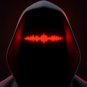

<p align="center"></p>

# Booth

Free, open-source text to speech. Type a line, pick a voice and a mood, and get takes to choose
from. Booth runs [ZONOS3-Mini](https://huggingface.co/Zyphra/ZONOS3-Mini) by Zyphra on your own
computer, on the graphics card or the processor, so nothing you write leaves it. Claude can use it too.

**Download:** [Windows](https://github.com/stepupgaming/booth/releases/latest/download/Booth-Setup.exe)
· [Mac (Apple Silicon)](https://github.com/stepupgaming/booth/releases/latest/download/Booth-mac.dmg)
· [Linux AppImage](https://github.com/stepupgaming/booth/releases/latest/download/Booth-linux.AppImage)
· [Website](https://nofacetube.com/tools/booth/) · [Releases](https://github.com/stepupgaming/booth/releases)

## What it does

- Preset voices with mood, pace, energy and delivery controls
- Several takes per line, so you pick the best read
- Scripts: whole scripts rendered line by line, each with its own voice and direction
- Voice cloning from a short clip, only of voices you have permission to use
- Voice design from a preset: shift gender, age, texture, accent and room
- Claude support: a one-click Claude Desktop extension (`booth.mcpb`) and an MCP server (`booth-mcp`)

## Requirements

- **Windows** 10 or 11, 64-bit. Runs on any modern processor. With an NVIDIA card (RTX 20 series
  or newer, recent driver) Booth offers a graphics-card engine that is several times faster.
- **Mac** with Apple Silicon (M1 or newer), macOS 13 or later. Runs on the Mac's graphics (Metal).
  New and not yet tested on real hardware.
- **Linux** x86-64 (AppImage or .deb). Processor only. New and not yet tested on real hardware.
- About 1.2 GB of disk for the voice model, up to 9 GB with every add-on.

The app comes with an engine for the processor (or Metal on a Mac). The model weights, and the NVIDIA
engine if you choose it, download on first launch. Booth updates itself: when a new version is out, a
note appears at the bottom left. On Windows your voices, takes and settings live in
`%LOCALAPPDATA%\NoFaceTube\Booth`.

Booth is not code-signed yet:

- Windows SmartScreen may warn about an unknown publisher. Choose **More info**, then **Run anyway**.
- macOS will say it can't check the app. Open **System Settings → Privacy & Security** and click
  **Open Anyway** next to Booth.

## Use it from Claude

In Booth, open **Settings** and click **Add to Claude Desktop**. Claude can then list voices, speak
lines and render scripts. The **Claude Code** tab next to it gives the `claude mcp add` command.

## Build from source

Needs Node 20+, pnpm, Rust stable, Bun, and the [Tauri prerequisites](https://v2.tauri.app/start/prerequisites/).

```bash
pnpm install
pnpm tauri dev                 # the app, against an engine in BOOTH_ENGINE_DIR
scripts/ui-preview.cmd         # the UI alone in a browser, on sample data, no GPU
pwsh scripts/build-mcpb.ps1    # booth-mcp and dist/booth.mcpb
```

The voice engine is `zonos3-server` from Zyphra's
[ZONOS3-Mini](https://github.com/Zyphra/ZONOS3-Mini) repo (`servers/ggml`): a CPU build with every
x86 instruction-set variant on Windows and Linux, a Metal build on macOS, and an optional CUDA build
for NVIDIA cards. `scripts/patch-zonos3.py` holds the small source patches, and
`.github/workflows/release.yml` shows the exact builds. Pushing a `v*` tag builds every platform and
attaches the installers and the updater's `latest.json` to that release.

| Folder              | What                                                     |
| ------------------- | -------------------------------------------------------- |
| `apps/native`       | The Tauri app                                            |
| `packages/core/src/booth` | The UI                                             |
| `crates/booth-core` | Engine control, voices, controls, model downloads        |
| `crates/booth-mcp`  | The MCP server Claude uses                               |
| `packaging/mcpb`    | The Claude Desktop extension manifest                    |

## Credits and license

Booth is made by [NoFaceTube](https://nofacetube.com) and released under the Apache License 2.0
(see `LICENSE`). The ZONOS3-Mini model and engine are by [Zyphra](https://www.zyphra.com) under the
Apache 2.0 (weights) and MIT (code) licenses; each engine includes that license as
`LICENSE-ZONOS3.txt`. The optional NVIDIA engine bundles NVIDIA CUDA runtime libraries under NVIDIA's
redistribution terms.

Clone only voices you own or have permission to use, and label AI voiceover where your platform
asks you to.
